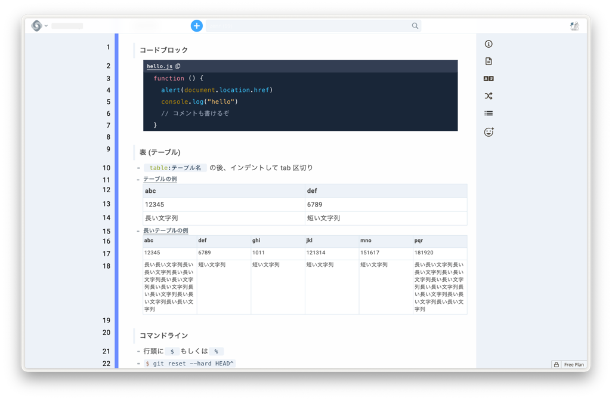
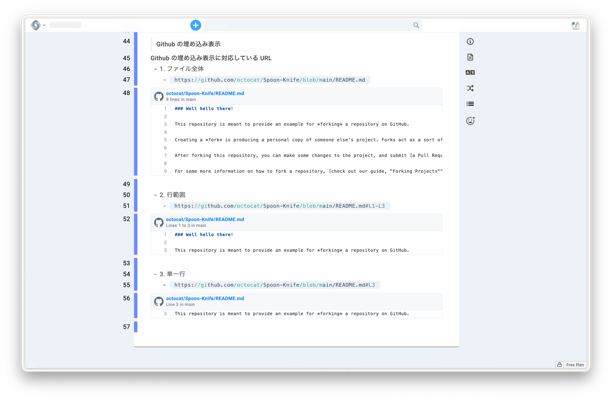
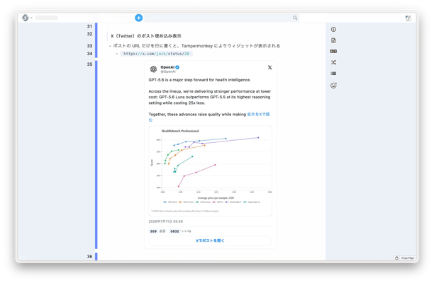

# Cosense Zenn Style

**日本語** | [English](README_en.md)

Cosense Zenn Style は、[Zenn の Markdown ガイド](https://zenn.dev/zenn/articles/markdown-guide)を参考に、[Cosense（旧 Scrapbox）](https://scrapbox.io/product)の読みやすさと表示機能を拡張する非公式のカスタマイズ集です。



Cosense が持つ編集体験はそのままに、見出し、引用、コード、表などの見た目を整えます。必要に応じて Tampermonkey を追加すると、GitHub のファイルや X（Twitter）のポストもカード形式で表示できます。

> [!CAUTION]
> UserCSS、UserScript、Tampermonkey のユーザースクリプトは、Web ページの見た目や動作を書き換える強力な機能です。  
> 内容を確認できないスクリプトは使用せず、設定前に自分のページの内容を控えておいてください。

## できること

### Cosense の基本カスタマイズ

`main_user_css_script_for_mypage.txt` を自分のページへ貼り付けると、次の表示や操作を変更できます。

- 背景色、本文幅、文字サイズ、行間（スマホ幅では文字を少し小さく表示）
- 見出し、マーカー、チェックボックス、箇条書き
- 引用
- Zenn の `:::message` 風のメッセージボックス
- インラインコードとコードブロック
- 表
- ナビゲーションバー
- 編集行とテキストカーソルの視認性
- ページ内見出しメニュー（見出しを階層付きで一覧表示）
- 広い画面で本文の横に追従する目次
- 見出しへのリンクのコピー
- 絵文字候補の検索と挿入
- Cosense のダーク系テーマへの対応

### Tampermonkey を使う追加機能

次の機能は任意です。基本カスタマイズだけを使う場合、[Tampermonkey](https://www.tampermonkey.net/) は必要ありません。

- 公開 GitHub リポジトリにあるテキストファイルの埋め込み
- X（Twitter）ポストの静的カード表示
- リプライ元ポストの表示・非表示
- 引用ポスト、画像、動画サムネイルなどの表示

## ファイル

| ファイル | 役割 |
| --- | --- |
| [`main_user_css_script_for_mypage.txt`](main_user_css_script_for_mypage.txt) | Cosense の自分のページへ貼り付ける UserCSS と UserScript |
| [`cosense_syntax_reference.txt`](cosense_syntax_reference.txt) | 見た目と埋め込み機能を確認するためのサンプルページ |
| [`cosense_github_embed_tampermonkey.user.js`](./tampermonkey/cosense_github_embed_tampermonkey.user.js) | GitHub ファイル埋め込み用の Tampermonkey スクリプト |
| [`cosense_x_post_embed_tampermonkey.user.js`](./tampermonkey/cosense_x_post_embed_tampermonkey.user.js) | X ポスト埋め込み用の Tampermonkey スクリプト |

## 動作環境

基本カスタマイズには、次のものが必要です。

- Cosense のアカウント
- カスタマイズを適用するプロジェクト内の「自分のページ」
- UserScript を有効にできる権限
- `:has()` などの比較的新しい CSS に対応したブラウザー

追加の埋め込み機能には、さらに次のものが必要です。

- [Tampermonkey](https://www.tampermonkey.net/)
- Chrome または Chromium 系ブラウザー

このプロジェクトの設定は、基本的に**設定した本人の画面だけ**へ適用されます。プロジェクト全体へ配布する ProjectCSS や ProjectScript を対象とした手順ではありません。

## セットアップ

まずは Cosense 内だけで完結する基本カスタマイズを設定します。GitHub や X の埋め込みは、基本表示を確認してから追加する方が問題を切り分けやすくなります。

### 1. UserScript を有効にする

1. Cosense の右上にある自分のアイコンまたは名前をクリックします。
2. **User settings** または **ユーザー設定** を開きます。
3. **Extensions** にある **UserScript** を有効にします。

表示名は Cosense の更新や表示言語によって少し異なる場合があります。

### 2. 自分のページを開く

右上のメニューから **Create my page** または **自分のページ** を選びます。

すでに自分のページがある場合は、そのページを開いてください。

### 3. 基本カスタマイズを貼り付ける

1. [`main_user_css_script_for_mypage.txt`](main_user_css_script_for_mypage.txt) を開きます。
2. ファイルの内容をすべてコピーします。
3. Cosense の自分のページで、空の行か通常の文字の行にカーソルを置いて貼り付けます。
4. Cosense のタブを再読み込みします。
5. 「UserScriptが更新されました」と表示されたら、自分のページの内容を確認してから **UserScriptを読み込む** を押します。

> [!NOTE]
> 引用（`>` で始まる行）にカーソルを置いたまま複数行を貼り付けると、Cosense の貼り付け時の変換が働き、記号やインデントが崩れることがあります。

このファイルには、次の2種類のコードブロックが含まれています。

```text
code:style.css
```

```text
code:script.js
```

`code:style.css` は見た目を変更し、`code:script.js` は見出しメニューや絵文字候補などの動作を追加します。コードブロックの名前やインデントを崩さないように、そのまま貼り付けてください。

### 4. 基本表示を確認する

1. Cosense で新しいページを作成します。
2. [`cosense_syntax_reference.txt`](cosense_syntax_reference.txt) の内容をすべてコピーします。
3. 新しいページへ貼り付けます。
4. 見出し、引用、コードブロック、表などの表示を確認します。

ここまでで、Tampermonkey を使わない基本カスタマイズは完了です。

## 使い方

### 見出し

`[*# 見出し]` のように、太字の記法に `#` を加えると見出しとして表示されます。`*` が多いほど大きな見出しになります。

```text
[***# 大きな見出し]
[**# 中くらいの見出し]
[*# 小さな見出し]
```

### メッセージボックス

Zenn の `:::message` と `:::message alert` に相当する囲みを、次の記法で書けます。

```text
[~ メッセージ]
[~! 警告メッセージ]
```

同じ種類の行が続くときは、1 つの囲みにまとめて表示します。

### 目次と見出しリンク

- 右側のページメニューにある「見出し」から、ページ内の見出しへ移動できます。`#` を含む見出しを `*` の数に応じた階層で表示し、`#` を含む見出しがないページでは `[** 見出し]` のような太字だけの行を使います。
- 画面幅が 1300px 以上のときは、見出しが 2 つ以上あるページで本文の右に目次を表示し、スクロール位置に合わせて現在の見出しを強調します。
- 見出しにマウスを重ねる（スマホでは見出しをタップする）と、その見出しへのリンク（ページの URL と行 ID）をコピーするボタンが表示されます。

### 絵文字候補

行頭・空白・日本語などの直後で `:` に続けて名前を入力すると、プロジェクト内のアイコン（画像を持ち、タイトルが英数字のページ）を候補として表示します。

- `↑` `↓`（または `Ctrl + P` / `Ctrl + N`）で選択し、`Enter` か `Tab` で挿入します。`Esc` で閉じます。
- `:名前:` と最後まで入力しても挿入できます。
- URL の `https:` や時刻の `12:30` のように、英数字の直後の `:` では候補を表示しません。
- ページメニューの「emoji」にある「load emojis from /emoji」を押すと、[/emoji](https://scrapbox.io/emoji) プロジェクトのアイコンも候補に加わります。画像を取得できないアイコンは、名前の頭文字で表示します。

### 配色と本文幅の調整

`[*# 配色と寸法]` のコードブロックにある CSS 変数を書き換えると、色や本文幅を変更できます。

| 変数 | 内容 | 初期値 |
| --- | --- | --- |
| `--zs-page-width` | 本文の最大幅 | `960px` |
| `--zs-toc-width` | 追従する目次の幅 | `240px` |
| `--zs-font-size` / `--zs-line-height` | 本文の文字サイズと行の高さ（画面幅 767px 以下では `16px` / `28px`） | `18px` / `32px` |
| `--zs-accent` | チェックボックス、新規ページボタン、目次などのアクセント色 | `#3ea8ff` |

プロジェクトのテーマが default-dark、paper-dark-dark、hacker1、hacker2 のときは、暗い背景向けの配色へ自動で切り替わります。ナビゲーションバーや背景など Cosense 本体の部分は、テーマの配色をそのまま使います。

## GitHub ファイルを埋め込む



Cosense のページには、外部通信を制限する CSP（Content Security Policy）があります。そのため、GitHub ファイルの取得処理は Cosense の UserScript ではなく、Tampermonkey 側で実行します。

### 1. Tampermonkey をインストールする

Chrome ウェブストアから [Tampermonkey](https://chromewebstore.google.com/detail/tampermonkey/dhdgffkkebhmkfjojejmpbldmpobfkfo?hl=ja) をインストールします。

### 2. Chrome でユーザースクリプトを許可する

Chrome 138 以降では、拡張機能ごとにユーザースクリプトの実行許可が必要です。

1. Chrome の拡張機能一覧を開きます。
2. Tampermonkey の **詳細** または **拡張機能を管理** を開きます。
3. **ユーザースクリプトを許可する** をオンにします。

この項目が見つからない場合は、Tampermonkey の[公式 FAQ](https://www.tampermonkey.net/faq.php?locale=ja&q=Q209)を確認してください。

### 3. GitHub 埋め込みスクリプトを登録する

1. Chrome 右上の Tampermonkey アイコンをクリックします。
2. **ダッシュボード**を開きます。
3. 上部の **＋**、または **新規スクリプトを追加**をクリックします。
4. エディターに最初から入っているテンプレートをすべて削除します。
5. [`cosense_github_embed_tampermonkey.user.js`](./tampermonkey/cosense_github_embed_tampermonkey.user.js) の内容をすべて貼り付けます。
6. `Command + S` または **ファイル → 保存**で保存します。
7. スクリプトが有効になっていることを確認します。
8. Cosense を再読み込みします。

### 4. GitHub 埋め込みを確認する

GitHub 上の公開テキストファイルの URL を、ほかの文字を付けずに1行だけ書きます。

ファイル全体を表示する場合:

```text
https://github.com/octocat/Spoon-Knife/blob/main/README.md
```

行範囲を指定する場合:

```text
https://github.com/octocat/Spoon-Knife/blob/main/README.md#L1-L3
```

1行だけ指定する場合:

```text
https://github.com/octocat/Spoon-Knife/blob/main/README.md#L3
```

URL の行へカーソルを移すと、編集できるように埋め込みカードが一時的に消えます。有効な URL を残したまま別の行へ移動すると、カードが再表示されます。URL を削除した場合は、カードも削除されます。

### GitHub 埋め込みの制限

- 公開リポジトリのファイルだけを対象とします。
- GitHub の認証トークンは使用しません。
- ソースコードや Markdown など、UTF-8 のテキストファイルだけを対象とします。
- 画像、動画、PDF、Office 文書、圧縮ファイルなどは表示しません。
- 取得するファイルサイズの上限は 2 MiB です。
- 一度に表示する行数の上限は 500 行です。
- リポジトリの既定ブランチを使う URL と、コミットを固定したパーマリンクの両方に対応します。

内容が変わらない埋め込みを残したい場合は、ブランチの URL よりもコミットを固定したパーマリンクが適しています。

## X（Twitter）のポストを埋め込む



X の公式埋め込みは iframe を使いますが、Cosense の CSP により iframe が表示できない場合があります。本リポジトリでは、Tampermonkey から投稿データを取得し、iframe を使わない静的なカードとして描画します。

### 1. X 埋め込みスクリプトを登録する

GitHub 埋め込みとは**別の新規スクリプト**として登録します。

1. Tampermonkey のダッシュボードを開きます。
2. **＋** または **新規スクリプトを追加**をクリックします。
3. 最初から入っているテンプレートをすべて削除します。
4. [`cosense_x_post_embed_tampermonkey.user.js`](./tampermonkey/cosense_x_post_embed_tampermonkey.user.js) の内容をすべて貼り付けます。
5. 保存し、スクリプトを有効にします。
6. Cosense を再読み込みします。

古い版を別のスクリプトとして残している場合は、同時に動かさず、使用する版だけを有効にしてください。

### 2. X 埋め込みを確認する

X または Twitter のポスト URL を、ほかの文字を付けずに1行だけ書きます。

```text
https://x.com/OpenAI/status/2075686461693898868
```

リプライの URL では、取得できる場合にリプライ元のポストも表示します。

リプライ元を表示しない場合は、`conversation=none` を指定します。

```text
https://x.com/example/status/1234567890?conversation=none
```

共有時に付く `s=20` などのクエリパラメーターが含まれていても、ポスト ID を取得できれば表示対象になります。

URL の行へカーソルを移すとカードが消え、URLを編集できます。URL を残したまま別の行へ移動するとカードが再表示され、URL を削除した場合はカードも削除されます。

### X 埋め込みの制限

- 公開状態で取得できるポストだけを対象とします。
- 非公開、削除済み、年齢制限などで取得できないポストは表示できません。
- 動画はページ内で直接再生せず、サムネイルから X を開きます。
- 投稿の取得には X の Syndication 用エンドポイントを利用しています。このエンドポイントは一般向け API として安定性が保証されたものではないため、X 側の変更で動作しなくなる可能性があります。
- 表示される返信数、リポスト数、いいね数は、取得時点の情報です。

## セキュリティ上の注意

Cosense の UserScript と Tampermonkey のユーザースクリプトは、対象ページの内容を読み取り、画面を書き換えられます。次の点を守ってください。

- 内容を確認していないスクリプトを貼り付けない
- GitHub の Personal Access Token、パスワード、秘密鍵をコードへ書かない
- Tampermonkey で同じ機能のスクリプトを複数同時に有効化しない
- `@match` や `@connect` が意図せず広げられていないか、更新時に確認する
- 不要になったスクリプトは無効化または削除する

現在の GitHub 埋め込みスクリプトは、`github.com` と `raw.githubusercontent.com` への通信を許可しています。X 埋め込みスクリプトは、`cdn.syndication.twimg.com` への通信を許可しています。

## トラブルシューティング

### 見た目が変わらない

次を順番に確認してください。

1. 自分のページへファイル全体を貼り付けたか
2. `code:style.css` の行と、その下のインデントが崩れていないか
3. Cosense を再読み込みしたか
4. 別のプロジェクトの自分のページへ貼り付けていないか

### 見出しメニューや絵文字候補が動かない

- UserScript が有効になっているか確認します。
- 「UserScriptが更新されました」と表示されている場合は、**UserScriptを読み込む** を押します。
- `code:script.js` のコードブロックが崩れていないか確認します。
- 設定後に Cosense を再読み込みします。

### Tampermonkey のスクリプトが動かない

- Tampermonkey 自体が有効か確認します。
- 対象スクリプトのスイッチが有効か確認します。
- Chrome の **ユーザースクリプトを許可する**がオンか確認します。
- 同じ機能の旧版が同時に有効になっていないか確認します。
- Cosense を再読み込みします。

### GitHub のカードが表示されない

- URL だけの行になっているか確認します。
- ディレクトリではなく、ファイルを開く `blob` URL か確認します。
- ファイルが公開されているか確認します。
- バイナリファイルや 2 MiB を超えるファイルではないか確認します。
- DevTools の Console で `[Cosense GitHub embed]` を含むエラーを確認します。

### X のカードが表示されない

- URL だけの行になっているか確認します。
- URL に `/status/数字` が含まれているか確認します。
- ポストが公開されているか確認します。
- DevTools の Console で `[Cosense static X embed]` を含むエラーを確認します。

## 元の表示へ戻す

### 基本カスタマイズを外す

自分のページへ追加した `code:style.css` と `code:script.js` の内容を削除し、Cosense を再読み込みします。

画面が操作しにくくなった場合は、ブラウザーの DevTools を使って一時的に CSS を無効化してから、自分のページを修正してください。

### 埋め込み機能を外す

Tampermonkey のダッシュボードで、対象スクリプトを無効化または削除し、Cosense を再読み込みします。

## 開発者向けメモ

`.pre-commit-config.yaml` には、コミット前に秘密情報を検査するための Gitleaks フックが含まれています。

## 注意事項

- 本プロジェクトは Zenn、Cosense、GitHub、X、Tampermonkey の公式プロジェクトではありません。
- Zenn の完全な複製ではなく、Cosense の仕組みを保ったまま、一部の見た目と表示機能を参考にしたカスタマイズです。
- Cosense の HTML 構造や各外部サービスの仕様変更により、将来修正が必要になる場合があります。

## 参考資料

- [Zenn の Markdown ガイド](https://zenn.dev/zenn/articles/markdown-guide)
- [Cosense UserCSS](https://scrapbox.io/help-jp/UserCSS)
- [Cosense UserScript](https://scrapbox.io/help-jp/UserScript)
- [Cosense 自分のページ](https://scrapbox.io/help-jp/%E8%87%AA%E5%88%86%E3%81%AE%E3%83%9A%E3%83%BC%E3%82%B8)
- [Tampermonkey 公式 FAQ: Permission to execute userscripts](https://www.tampermonkey.net/faq.php?locale=ja&q=Q209)

## 謝辞

ページ内見出しメニューは、Cosense 上の「[ページの見出しを作る UserScript](https://scrapbox.io/daiiz/%E3%83%9A%E3%83%BC%E3%82%B8%E3%81%AE%E8%A6%8B%E5%87%BA%E3%81%97%E3%82%92%E4%BD%9C%E3%82%8BUserScript)」を参考にしています。絵文字候補機能は、「[emoji selector](https://scrapbox.io/yutaro/emoji_selector)」を参考にしています。

Zenn、Cosense、および各カスタマイズ例の作者・コミュニティに感謝します。
