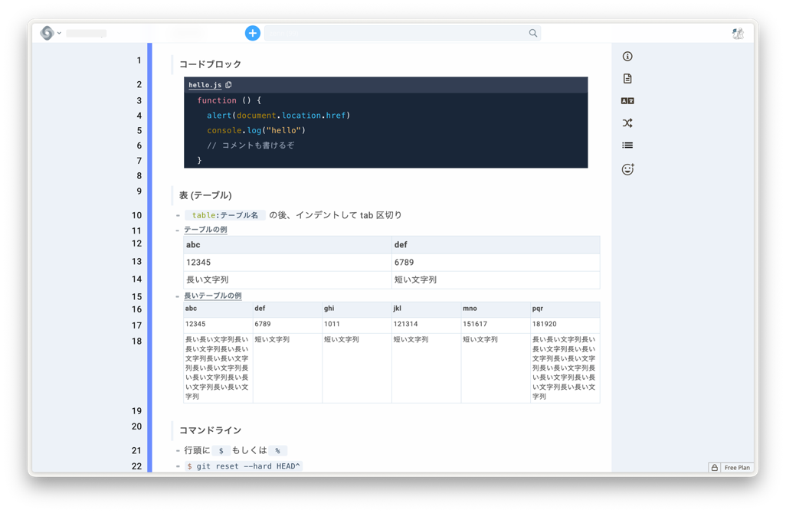
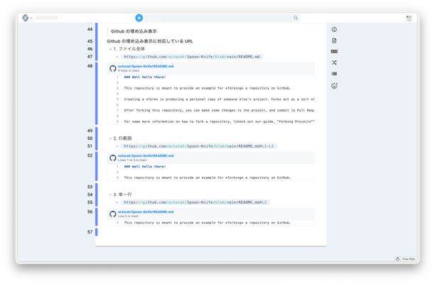
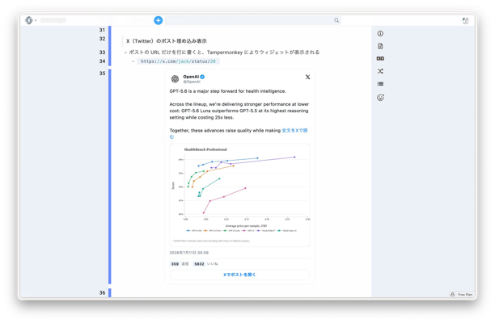

# Cosense Zenn Style

[日本語](README.md) | **English**

Cosense Zenn Style is an unofficial collection of customizations inspired by the [Zenn Markdown Guide](https://zenn.dev/zenn/articles/markdown-guide). It improves readability and adds display features to [Cosense, formerly known as Scrapbox](https://scrapbox.io/product).



It keeps the core Cosense editing experience intact while refining the appearance of headings, blockquotes, code, tables, and other elements. With the optional Tampermonkey scripts, you can also display GitHub files and X (Twitter) posts as embedded cards.

> [!CAUTION]
> UserCSS, UserScript, and Tampermonkey userscripts are powerful features that can change how web pages look and behave.  
> Do not install scripts whose contents you cannot verify, and make a backup of your My Page before changing its settings.

## Features

### Basic Cosense customizations

Paste `main_user_css_script_for_mypage.txt` into your My Page to customize the following elements and behaviors:

- Background color, content width, font size, and line spacing (slightly smaller text on narrow screens)
- Headings, highlights, checkboxes, and bullet lists
- Blockquotes
- Inline code and code blocks
- Tables
- Navigation bar
- Visibility of the active line and text cursor
- In-page heading menu (headings listed with their hierarchy)
- A sticky table of contents next to the page on wide screens
- Copying links to headings
- Emoji search and insertion
- Support for Cosense dark themes

### Optional features using Tampermonkey

The following features are optional. You do not need [Tampermonkey](https://www.tampermonkey.net/) if you only want the basic customizations.

- Embedding text files from public GitHub repositories
- Displaying X (Twitter) posts as static cards
- Showing or hiding the parent post of a reply
- Displaying quoted posts, images, video thumbnails, and related content

## Files

| File | Purpose |
| --- | --- |
| [`main_user_css_script_for_mypage.txt`](main_user_css_script_for_mypage.txt) | UserCSS and UserScript to paste into your Cosense My Page |
| [`cosense_syntax_reference.txt`](cosense_syntax_reference.txt) | Sample page for checking the appearance and embed features |
| [`cosense_github_embed_tampermonkey.user.js`](./tampermonkey/cosense_github_embed_tampermonkey.user.js) | Tampermonkey script for embedding GitHub files |
| [`cosense_x_post_embed_tampermonkey.user.js`](./tampermonkey/cosense_x_post_embed_tampermonkey.user.js) | Tampermonkey script for embedding X posts |

## Requirements

The basic customizations require:

- A Cosense account
- A My Page in the project where you want to apply the customizations
- Permission to enable UserScript
- A browser that supports relatively recent CSS features such as `:has()`

The optional embed features additionally require:

- [Tampermonkey](https://www.tampermonkey.net/)
- Chrome or another Chromium-based browser

These settings normally apply **only to the person who configured them**. This guide does not cover ProjectCSS or ProjectScript, which apply customizations across an entire project.

## Setup

Start with the basic customizations, which run entirely inside Cosense. Add the GitHub and X embeds afterward so that any problems are easier to isolate.

### 1. Enable UserScript

1. Click your profile icon or name in the upper-right corner of Cosense.
2. Open **User settings**.
3. Enable **UserScript** under **Extensions**.

The exact labels may vary slightly depending on the Cosense version or display language.

### 2. Open your My Page

Select **Create my page** or **My Page** from the menu in the upper-right corner.

If you already have a My Page, open that page instead.

### 3. Paste the basic customizations

1. Open [`main_user_css_script_for_mypage.txt`](main_user_css_script_for_mypage.txt).
2. Copy the entire file.
3. In your Cosense My Page, place the cursor on an empty line or a regular text line, then paste.
4. Reload the Cosense tab.
5. If Cosense shows a banner saying that your UserScript has been updated, review your My Page and then click the button in the banner to load the UserScript.

> [!NOTE]
> If you paste multiple lines while the cursor is on a blockquote line (a line starting with `>`), Cosense transforms the pasted text and may break symbols or indentation.

The file contains the following two types of code blocks:

```text
code:style.css
```

```text
code:script.js
```

`code:style.css` changes the appearance of Cosense. `code:script.js` adds behaviors such as the heading menu and emoji suggestions. Paste the file as-is so that the code block names and indentation remain intact.

### 4. Check the basic appearance

1. Create a new page in Cosense.
2. Copy the entire contents of [`cosense_syntax_reference.txt`](cosense_syntax_reference.txt).
3. Paste them into the new page.
4. Check the appearance of headings, blockquotes, code blocks, tables, and other elements.

The basic customizations are now complete. Tampermonkey is not required up to this point.

## Usage

### Headings

Add `#` to the bold notation, as in `[*# Heading]`, to display a line as a heading. More `*` characters produce a larger heading.

```text
[***# Large heading]
[**# Medium heading]
[*# Small heading]
```

### Table of contents and heading links

- Use **見出し** (Headings) in the page menu on the right to jump to a heading on the page. Headings containing `#` are listed with a hierarchy based on the number of `*` characters. On pages without such headings, lines that consist only of bold text, such as `[** Heading]`, are used instead.
- On screens 1300px or wider, pages with two or more headings show a table of contents to the right of the page. The current heading is highlighted as you scroll.
- When you hover over a heading (or tap it on a phone), a button appears that copies a link to that heading (the page URL with the line ID).

### Emoji suggestions

Type `:` followed by a name at the start of a line or after a space or Japanese text to see suggestions from the icons in your project (pages with an image and an alphanumeric title).

- Use `↑` / `↓` (or `Ctrl + P` / `Ctrl + N`) to select, and press `Enter` or `Tab` to insert. Press `Esc` to close the list.
- You can also insert an icon by typing the full `:name:`.
- Suggestions do not appear for a `:` right after a letter or digit, such as `https:` in a URL or `12:30`.
- Click **load emojis from /emoji** under **emoji** in the page menu to add the icons of the [/emoji](https://scrapbox.io/emoji) project. Icons whose images cannot be loaded are shown with the first letter of their names.

### Adjusting colors and width

Edit the CSS custom properties in the `[*# 配色と寸法]` code block to change colors and the content width.

| Property | Description | Default |
| --- | --- | --- |
| `--zs-page-width` | Maximum width of the page content | `960px` |
| `--zs-toc-width` | Width of the sticky table of contents | `240px` |
| `--zs-font-size` / `--zs-line-height` | Font size and line height of the text (`16px` / `28px` on screens 767px wide or narrower) | `18px` / `32px` |
| `--zs-accent` | Accent color for checkboxes, the new page button, the table of contents, and more | `#3ea8ff` |

When the project theme is default-dark, paper-dark-dark, hacker1, or hacker2, the colors automatically switch to a palette for dark backgrounds. Cosense's own interface, such as the navigation bar and background, keeps the theme colors.

## Embedding GitHub files



Cosense applies a Content Security Policy (CSP) that restricts external connections from page scripts. For this reason, GitHub files are fetched by Tampermonkey rather than by Cosense UserScript.

### 1. Install Tampermonkey

Install [Tampermonkey](https://chromewebstore.google.com/detail/tampermonkey/dhdgffkkebhmkfjojejmpbldmpobfkfo?hl=en) from the Chrome Web Store.

### 2. Allow userscripts in Chrome

In Chrome 138 or later, you must explicitly allow extensions to execute userscripts.

1. Open Chrome's extensions page.
2. Open **Details** or **Manage extension** for Tampermonkey.
3. Turn on **Allow User Scripts**.

If you cannot find this option, see the [official Tampermonkey FAQ](https://www.tampermonkey.net/faq.php?locale=en&q=Q209).

### 3. Register the GitHub embed script

1. Click the Tampermonkey icon in the upper-right corner of Chrome.
2. Open the **Dashboard**.
3. Click the **+** tab or **Add a new script**.
4. Delete the template code that appears in the editor.
5. Paste the complete contents of [`cosense_github_embed_tampermonkey.user.js`](./tampermonkey/cosense_github_embed_tampermonkey.user.js).
6. Save it with `Command + S` or **File → Save**.
7. Confirm that the script is enabled.
8. Reload Cosense.

### 4. Test a GitHub embed

Place the URL of a text file in a public GitHub repository on a line by itself.

To display the whole file:

```text
https://github.com/octocat/Spoon-Knife/blob/main/README.md
```

To display a range of lines:

```text
https://github.com/octocat/Spoon-Knife/blob/main/README.md#L1-L3
```

To display a single line:

```text
https://github.com/octocat/Spoon-Knife/blob/main/README.md#L3
```

When you move the cursor to the URL line, the card temporarily disappears so that you can edit the URL. If you leave a valid URL and move to another line, the card appears again. If you delete the URL, the card is also removed.

### GitHub embed limitations

- Only files in public repositories are supported.
- No GitHub authentication token is used.
- Only UTF-8 text files, such as source code and Markdown files, are supported.
- Images, videos, PDFs, Office documents, archives, and other binary files are not displayed.
- The maximum downloaded file size is 2 MiB.
- A maximum of 500 lines is displayed at once.
- Both URLs using a repository branch and permanent links pinned to a commit are supported.

Use a commit-pinned permanent link instead of a branch URL when the embedded content must remain unchanged.

## Embedding X (Twitter) posts



The official X embed uses an iframe, which may be blocked by the Cosense CSP. This repository instead fetches post data through Tampermonkey and renders it as a static card without an iframe.

### 1. Register the X embed script

Register this as a **separate Tampermonkey script** from the GitHub embed.

1. Open the Tampermonkey Dashboard.
2. Click **+** or **Add a new script**.
3. Delete the template code in the editor.
4. Paste the complete contents of [`cosense_x_post_embed_tampermonkey.user.js`](./tampermonkey/cosense_x_post_embed_tampermonkey.user.js).
5. Save and enable the script.
6. Reload Cosense.

If you still have an older version registered as another script, enable only the version you intend to use. Do not run multiple versions of the same embed script at the same time.

### 2. Test an X embed

Place an X or Twitter post URL on a line by itself.

```text
https://x.com/OpenAI/status/2075686461693898868
```

For replies, the parent post is also displayed when the data is available.

To hide the parent post, add `conversation=none`:

```text
https://x.com/example/status/1234567890?conversation=none
```

Tracking parameters added when sharing a post, such as `s=20`, do not prevent embedding as long as the script can extract the post ID.

When you move the cursor to the URL line, the card disappears so that you can edit the URL. If you keep a valid URL and move to another line, the card appears again. If you delete the URL, the card is also removed.

### X embed limitations

- Only publicly accessible posts are supported.
- Private, deleted, age-restricted, or otherwise unavailable posts cannot be displayed.
- Videos are not played directly inside the page. Clicking a thumbnail opens the post on X.
- Post data is retrieved through an X Syndication endpoint. Because this endpoint is not guaranteed to be a stable public API, changes made by X may break the feature.
- Reply, repost, and like counts reflect the data available when the post was fetched.

## Security notes

Cosense UserScript and Tampermonkey userscripts can read content from their target pages and modify what is displayed. Follow these precautions:

- Do not paste scripts whose contents you have not reviewed.
- Do not put GitHub Personal Access Tokens, passwords, private keys, or other secrets in the code.
- Do not enable multiple versions of the same Tampermonkey feature at the same time.
- When updating a script, check that `@match` and `@connect` have not been broadened unexpectedly.
- Disable or remove scripts that you no longer use.

The GitHub embed script currently allows connections to `github.com` and `raw.githubusercontent.com`. The X embed script allows connections to `cdn.syndication.twimg.com`.

## Troubleshooting

### The appearance does not change

Check the following in order:

1. Did you paste the entire file into your My Page?
2. Are the `code:style.css` line and the indentation below it intact?
3. Did you reload Cosense?
4. Did you paste the file into the My Page of a different project by mistake?

### The heading menu or emoji suggestions do not work

- Confirm that UserScript is enabled.
- If Cosense shows a banner saying that your UserScript has been updated, click the button in the banner to load the UserScript.
- Check that the `code:script.js` code blocks and their indentation are intact.
- Reload Cosense after applying the settings.

### A Tampermonkey script does not run

- Confirm that Tampermonkey itself is enabled.
- Confirm that the target script is enabled.
- Confirm that **Allow User Scripts** is enabled in Chrome.
- Check that an older version of the same feature is not enabled at the same time.
- Reload Cosense.

### A GitHub card does not appear

- Confirm that the URL is the only content on its line.
- Confirm that the URL is a `blob` URL for a file, not a directory.
- Confirm that the file is publicly accessible.
- Confirm that the file is not binary and does not exceed 2 MiB.
- Open DevTools and check the Console for an error containing `[Cosense GitHub embed]`.

### An X card does not appear

- Confirm that the URL is the only content on its line.
- Confirm that the URL contains `/status/` followed by a numeric post ID.
- Confirm that the post is publicly accessible.
- Open DevTools and check the Console for an error containing `[Cosense static X embed]`.

## Restoring the original appearance

### Remove the basic customizations

Delete the `code:style.css` and `code:script.js` content that you added to your My Page, then reload Cosense.

If the page becomes difficult to operate, temporarily disable the custom CSS in your browser's DevTools and then edit your My Page.

### Remove an embed feature

Disable or delete the relevant script in the Tampermonkey Dashboard, then reload Cosense.

## Notes for contributors

`.pre-commit-config.yaml` includes a Gitleaks hook that checks for secrets before commits are created.

## Disclaimer

- This project is not affiliated with or endorsed by Zenn, Cosense, GitHub, X, or Tampermonkey.
- It does not attempt to reproduce Zenn exactly. It adapts selected visual styles and display features while preserving the Cosense editing model.
- Changes to the Cosense HTML structure or to the external services used by these scripts may require future updates.

## References

- [Zenn Markdown Guide](https://zenn.dev/zenn/articles/markdown-guide)
- [Cosense UserCSS](https://scrapbox.io/help-jp/UserCSS)
- [Cosense UserScript](https://scrapbox.io/help-jp/UserScript)
- [Cosense My Page](https://scrapbox.io/help-jp/%E8%87%AA%E5%88%86%E3%81%AE%E3%83%9A%E3%83%BC%E3%82%B8)
- [Tampermonkey FAQ: Permission to execute userscripts](https://www.tampermonkey.net/faq.php?locale=en&q=Q209)

## Acknowledgements

The in-page heading menu is based on the Cosense community script [ページの見出しを作る UserScript](https://scrapbox.io/daiiz/%E3%83%9A%E3%83%BC%E3%82%B8%E3%81%AE%E8%A6%8B%E5%87%BA%E3%81%97%E3%82%92%E4%BD%9C%E3%82%8BUserScript). The emoji suggestion feature is based on [emoji selector](https://scrapbox.io/yutaro/emoji_selector).

Thanks to Zenn, Cosense, and the authors and communities behind the customization examples used by this project.
